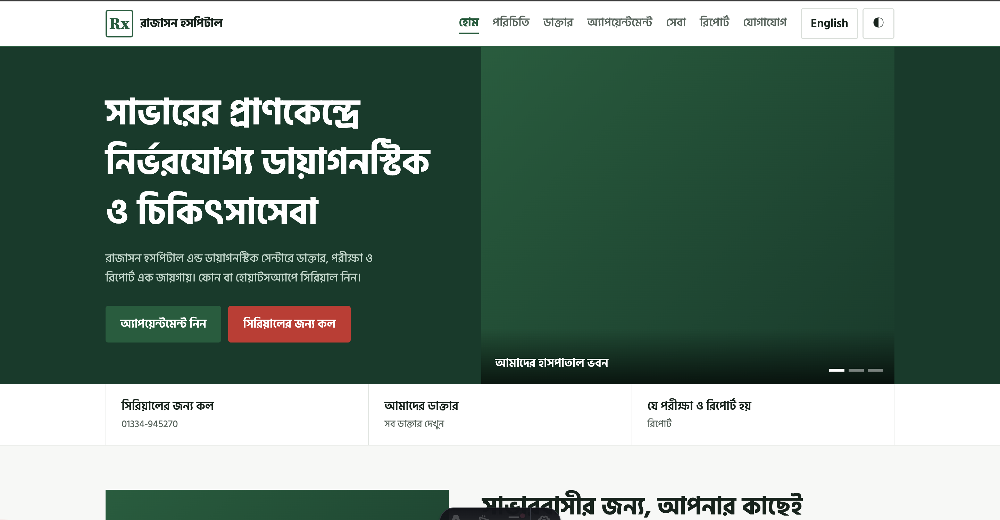

# Rajashon Hospital & Diagnostic Center

## Demo



## Run locally

```bash
npm install
npm run dev
```

Edit all content in src/data/site.js. Photos in public/images/: slide-1..3, building, doctor-1..3 (+ optional doctor-1-full.jpg for the popup), service-1..6 (.jpg).
